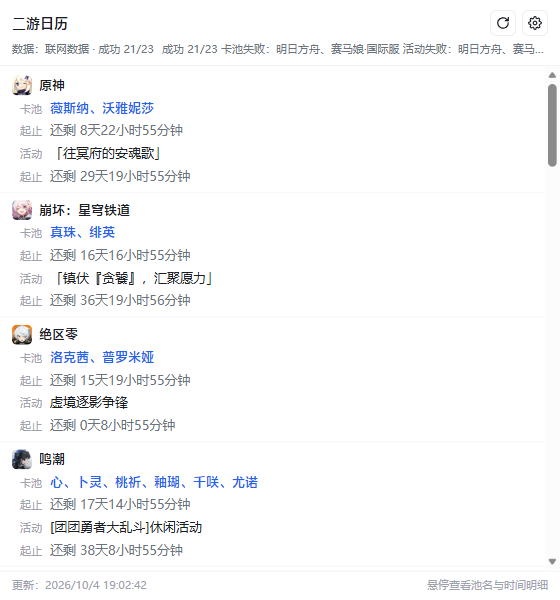
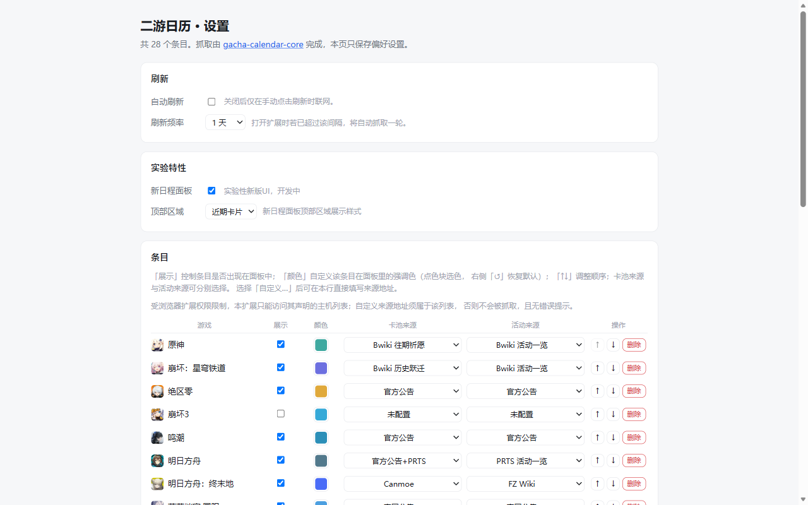
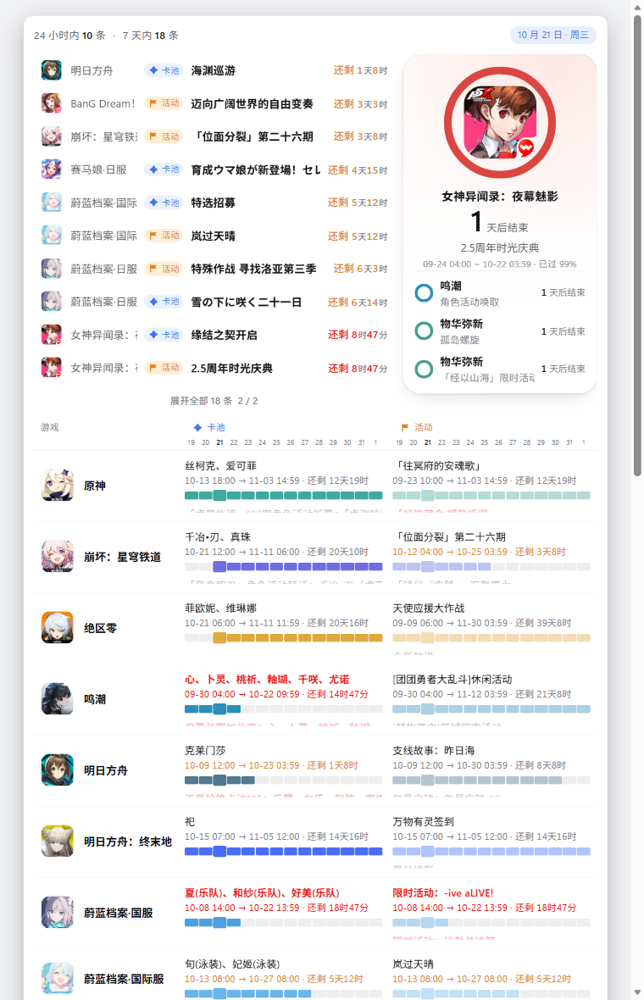

# 二游日历 · 浏览器扩展

**28 款**二次元手游的**当期卡池与活动起止**一览，点浏览器工具栏图标即可查看。
Chrome / Edge 通用（Manifest V3）。

## 截图

  

  

## 功能

- **一览式面板**：每款游戏两行——当期卡池（外显 UP 角色）与当期活动，右侧是**倒计时**（还剩 X 天 X 小时 X 分钟）
- **悬停看细节**：卡池可看完整池名、UP 角色与时间原文；活动可看完整名称与起止时间
- **刷新与降级**：抓取失败时该列沿用上次成功的数据，并在面板上标出，不会静默显示过期内容
- **来源可切换**：每款游戏的卡池与活动来源可分别切换，也可填写自定义来源地址
- **设置页**：展示开关、条目排序、删除与恢复、刷新频率、**解析器自检**
- **轻量**：不注入任何网页、不收集任何数据，权限只有 `storage` 与具体数据源域名

## 已支持的游戏

共 **28 款**。带 ※ 的条目出厂默认不勾选（避免首次打开就铺满），在设置页勾上即可开始抓取；
带 † 的条目没有默认来源，需在设置页选用一个备选源。

| 游戏 | | 游戏 | |
|---|---|---|---|
| 原神 | | 物华弥新 | |
| 崩坏：星穹铁道 | | 战双帕弥什 | |
| 绝区零 | | 卡厄斯梦境 | ※ |
| 崩坏3 | ※ † | 雪松 | |
| 鸣潮 | | 嘟嘟脸恶作剧 | ※ |
| 明日方舟 | | 闪耀！优俊少女 | |
| 明日方舟：终末地 | | 赛马娘·日服 | |
| 蔚蓝档案·国服 | | 赛马娘·国际服 | |
| 蔚蓝档案·国际服 | | 女神异闻录：夜幕魅影 | |
| 蔚蓝档案·日服 | | 异环 | |
| BanG Dream！少女乐团派对·国服 | | 少女前线2：追放 | |
| BanG Dream！OurNotes·日服 | ※ | Fate/Grand Order | |
| BanG Dream！OurNotes·国际服 | ※ † | 初音未来：缤纷舞台·国服 | |
| | | 星塔旅人 | |
| | | 重返未来：1999 | |

## 数据来源

排期数据实时抓取自各游戏**官方公告**与社区 Wiki（Bwiki / PRTS / FZ Wiki / GameKee / GameTora 等）。

所有请求由你的浏览器**直接发往**这些来源站；扩展本身不经过任何中转服务器。
采用克制的抓取策略，并支持自定义刷新频率（默认按天），正常使用不会对来源站造成压力。

## 安装

### 从 Edge 加载项商店安装（推荐）

打开 [商店页](https://microsoftedge.microsoft.com/addons/detail/mkfokebcmknjnbjceabimdchdfhbdhhc) → 点「获取」。
商店版会**自动更新**，无需手动操作。

### 手动加载（开发者模式）

1. 到 [Releases](https://github.com/EastMG/gacha-calendar-extension/releases) 下载最新的
   `gacha-calendar-extension-<版本>.zip` 并解压（解压后 `manifest.json` 应在第一层）
2. 打开 `edge://extensions` 或 `chrome://extensions`
3. 打开「开发人员模式」
4. 点「加载解压缩的扩展」，选择解压出来的目录
5. 点工具栏的「二游日历」图标 → 首次打开会自动抓一轮（约 5～15 秒）

> 从旧版本升级时，若本次新增了数据源域名，浏览器会要求**重新确认一次权限**，属正常现象。

## 使用

- **工具栏图标**：弹出面板；右上角按钮为「刷新」与「打开设置」
- **设置页**：可开关每一款的展示、调整顺序、删除与恢复条目、切换来源、调整刷新频率
- **解析器自检**：设置页底部「开始自检」会逐个来源跑一遍，报告哪个源解析不出当期内容、
  哪个源抓取报错——源站改版时可一键定位问题（只读，不改动你的设置与缓存）

### 关于「自定义条目」

本扩展支持为**已有条目**填写自定义来源地址，但**不提供新增自定义条目**。

原因与浏览器扩展的权限模型有关：`host_permissions` 必须在构建期静态声明，运行期无法添加。
自定义条目几乎必然指向未声明的域名，做出来只会"填了却抓不到"，因此不提供该功能。
自定义来源地址同样受此限制——输入框会提示可用的主机范围。

### 新日程面板（实验特性）

设置页 → **实验特性** → 勾选「新日程面板」。开启后点工具栏图标会**直接打开一个日程视图页面**
（而不是弹出小面板），包含：

  

- **总览行**：24 小时内 / 7 天内的条目数，右侧日期胶囊
- **近期列表**：按紧迫度排序的在期条目，每 4 秒轮换一批，可「展开全部」
- **日程表**：每款游戏一行，卡池 / 活动两栏，各带 14 天迷你进度条与倒计时
- **留白卡**：右侧悬浮卡，显示最紧迫的那条及后续几条

该视图需要较大的画布（整表 23 行约 2500px 高），弹出窗口放不下，因此改为独立页面。
**默认关闭**；关闭时行为与之前完全一致。

## 隐私

- **不收集任何个人数据**，不上传任何内容，不含统计与广告代码
- **不含 content script**，不会读取或修改你正在浏览的任何网页
- 仅在本地保存两类信息：你的偏好设置，以及最近一次成功抓取的缓存
- 完整说明见[隐私政策](https://eastmg.github.io/gacha-calendar-extension/privacy.html)

## 致谢

数据获取手段受以下开源项目启发，特此致谢：

- [MAA1999/M9A](https://github.com/MAA1999/M9A)——《重返未来：1999》逐期「征集时间」的获取思路
- [yoimiya-kokomi/miao-plugin](https://github.com/yoimiya-kokomi/miao-plugin)——miHoYo/HoYoverse 公告接口
- [jacket-sikaha/game-schedule](https://github.com/jacket-sikaha/game-schedule)——miHoYo/HoYoverse 公告接口
- [BTMuli/ShufflePlay](https://github.com/BTMuli/ShufflePlay)——miHoYo/HoYoverse 公告接口
- [UIGF-org/mihoyo-api-collect](https://github.com/UIGF-org/mihoyo-api-collect)——`appId` 与公告接口查证
- [Sekai-World/sekai-master-db-cn-diff](https://github.com/Sekai-World/sekai-master-db-cn-diff)——
  《初音未来：缤纷舞台》国服卡池与活动排期的数据来源

## 免责声明

- 本项目为非营利性质的个人项目，与各游戏厂商、发行商及官方/社区 Wiki 均不存在隶属或合作关系。
- 卡池、活动等排期数据均取自各游戏**公开的官方公告与社区 Wiki**；图标与截图的版权归原权利方所有，
  本项目仅作信息聚合展示，不提供亦不存储任何游戏资源。
- **图标资源使用外链**，来自游戏官网自有静态资源或应用商店列表图标。
- 如权利人认为本项目展示的内容侵犯其合法权益，请通过
  [Issue](https://github.com/EastMG/gacha-calendar-extension/issues) 告知，核实后将尽快删除相关内容。

## License

MIT

---

源码结构、构建方式与设计要点见 **[README_Dev.md](README_Dev.md)**。

